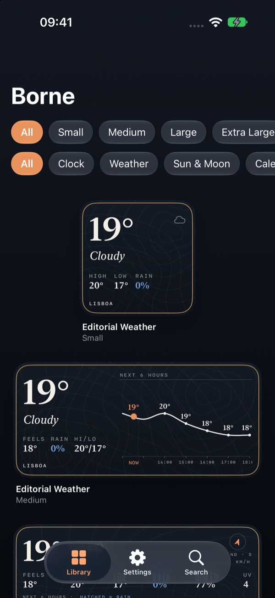
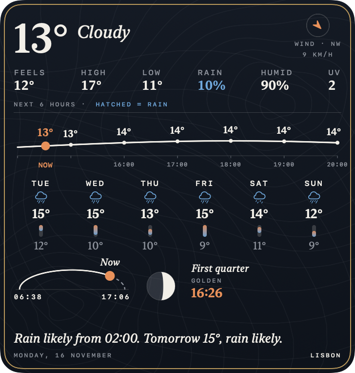
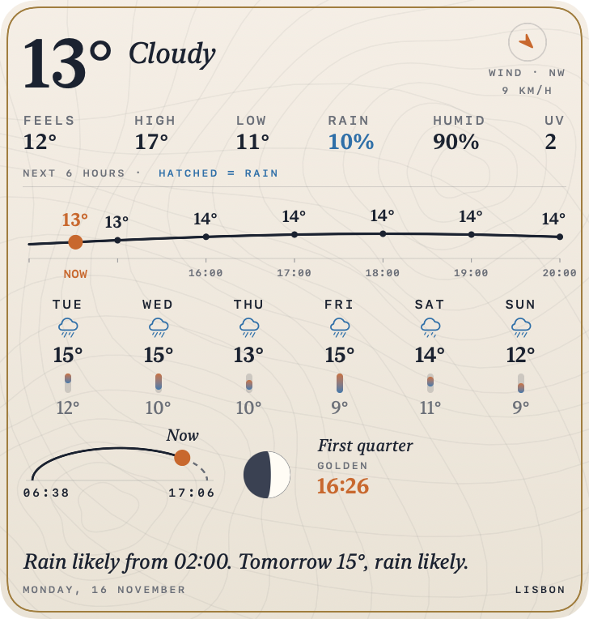
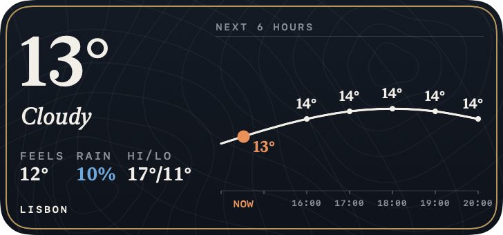
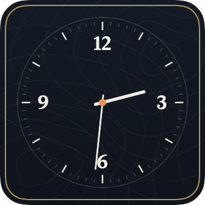
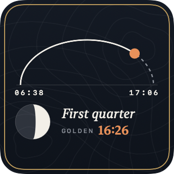
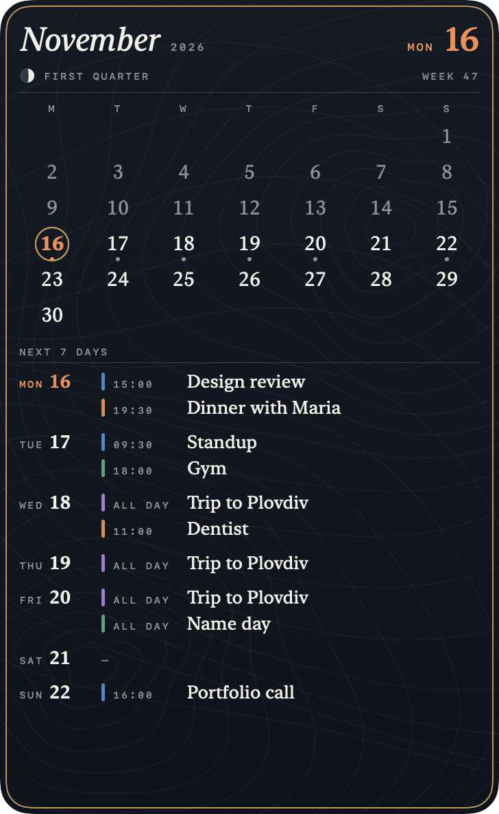
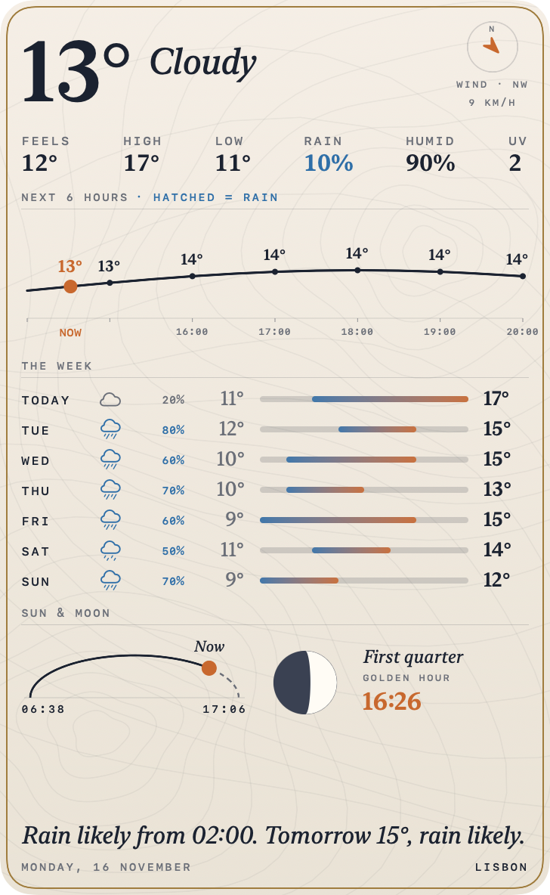
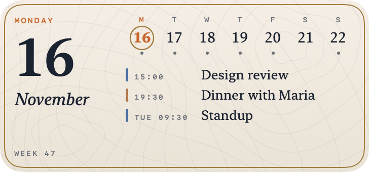

# Borne Widgets

A library of carefully typeset iOS home-screen widgets. Browse designs by size, category and style inside a native Liquid Glass app, then add them from the iOS widget gallery.

The first style is **Editorial**: serif numerals, small-caps labels, hairline rules and a thin gold keyline, like an almanac printed on slate. Widgets follow the iPhone's appearance: slate in Dark Mode, warm paper and ink in Light Mode.

<p>
  
  
  
</p>
<p>
  
  
  
</p>
<p>
  
  
  
</p>

## Widgets

| Design | Small | Medium | Large |
|---|---|---|---|
| Editorial Weather (+ full-page on iOS 27) | temperature, condition, high/low/rain | temperature + 6-hour curve with hatched rain | the full page: stats, 6-hour curve, six-day strip, sun arc, moon phase, golden hour, one-line summary |
| Editorial Clock | analog face | typeset time, weekday, week & day of year | local time + up to three world clocks |
| Editorial Sun & Moon | sun arc + moon phase + golden hour | – | – |
| Editorial Calendar (+ full-page on iOS 27) | date + next event | date, this week, next three events | month grid + today's events; full page adds a 7-day agenda |

## Requirements

- Xcode 27 or newer, iOS 26 or newer
- [XcodeGen](https://github.com/yonaskolb/XcodeGen) (`brew install xcodegen`)

No API keys and no paid developer account are needed: weather comes from [Open-Meteo](https://open-meteo.com).

## Build & run

```sh
xcodegen                 # generates BorneWidgets.xcodeproj (not committed)
open BorneWidgets.xcodeproj
```

Pick the **BorneWidgets** scheme and an iPhone simulator, then Run. Or from the command line:

```sh
./build.sh               # builds for an iPhone 17 simulator
swift test --package-path BorneKit
```

Then long-press the simulator's Home Screen → **Edit → Add Widget** → search **Borne**.

### Running on your iPhone

```sh
cp Config/Local.xcconfig.example Config/Local.xcconfig
```

Set `DEVELOPMENT_TEAM` to your team ID and `BUNDLE_PREFIX` to a reverse-DNS prefix you own (bundle IDs and the App Group are derived from it). `Local.xcconfig` is git-ignored.

## How it's built

```
App/               SwiftUI app: Liquid Glass library, design detail, settings
WidgetExtension/   WidgetKit extension: one widget per design + timeline providers
BorneKit/          Local Swift package shared by both
  BorneCore/       Foundation-only: models, Open-Meteo client, cache, settings,
                   moon phase & sun times, summary sentence, design catalog
  BorneDesigns/    SwiftUI views, one folder per style (Styles/Editorial/…)
```

- **One source of truth for rendering.** `DesignRegistry.view(for:weather:clock:)` draws every design; the app previews and the widgets both go through it, so what you see in the library is what lands on your Home Screen.
- **Shared data.** The app and the widgets share an App Group: settings in `UserDefaults`, the latest forecast as JSON. Weather is refetched at most every 30 minutes, or right away when the location changes.
- **Native Liquid Glass.** System containers (`TabView`, toolbars, sheets) plus `glassEffect`, `GlassEffectContainer` and the glass button styles. No hand-made blur.
- **Appearance.** Widgets switch between slate and paper with the system Light/Dark setting (`colorScheme`), and adapt to tinted and clear Home Screens through `widgetRenderingMode`. All colours come from `EditorialPalette`.

## Adding a style

1. Add a case to `WidgetStyle` in `BorneCore/Registry/DesignCatalog.swift`.
2. Create `BorneDesigns/Styles/<Style>/` with its theme and views.
3. Add `DesignInfo` entries to `DesignCatalog` and route them in `DesignRegistry`.
4. Add a `Widget` per design in `WidgetExtension/Widgets/` and list it in `BorneWidgetBundle`.

The library's Style filter appears automatically once there is more than one style.

To preview every design as PNGs: `RENDER_DIR=/tmp/borne swift test --package-path BorneKit --filter renderAllCards`.

## Credits

Weather data by [Open-Meteo.com](https://open-meteo.com) (CC BY 4.0).

## License

MIT, see [LICENSE](LICENSE).
